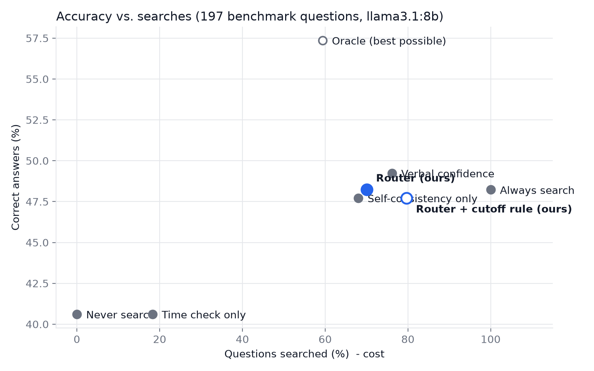

# Temporal-Risk Router

**Knowing when to search: a dual-signal router for incomplete and outdated knowledge in large language models.**

A language model only knows what it learned up to its training cutoff. Its answers can be
**outdated** (the world changed since) or **incomplete** (it never learned the fact), and it often
sounds confident either way. This project decides, *before* the model answers, whether it can
answer from memory or must look the answer up first.

## How it works

Every question goes through two checks:

| Check | Question it asks | Method | Catches |
|---|---|---|---|
| **1. Time check** | Does the answer change over time? | TF-IDF + logistic regression classifier (LOW / MAYBE / HIGH) | outdated knowledge |
| **2. Knowledge check** | Does the AI actually know it? | Self-consistency: ask 3 times; disagreement or "I don't know" = unsure | incomplete knowledge |

The router combines them:

| | AI knows it | AI unsure |
|---|---|---|
| **LOW** (never changes) | answer from memory | **search** (incomplete knowledge) |
| **MAYBE** (changes sometimes) | answer + recency warning | **search** |
| **HIGH** (changes often) | **search** (may be outdated) | **search** |

When it searches, the pipeline looks the question up on Wikipedia, gives the most relevant
passages to the model, and the model answers **only from those sources**, citing them with the
date they were retrieved. The model is told today's date and to use the most recent information
in the sources, because a search can also return outdated facts. If the sources do not contain the answer, it says so instead of guessing.

Why two checks? A knowledge check alone misses answers that are *confident but outdated*;
a time check alone misses *stable facts the model never learned*. Most adaptive-retrieval work
uses only one of these signals.

## Project structure

```
temporal-risk-router/
├── data/
│   ├── time_check_train.csv   150 labelled questions (LOW / AMBIGUOUS / HIGH) to train Check 1
│   ├── time_check_test.csv    30 separate questions to test Check 1
│   ├── router_test.csv        45 questions to test the router (15 stable-common, 15 stable-rare, 15 changing)
│   ├── answer_test.csv        31 questions with verified correct answers and sources
│   ├── benchmark.csv          200 questions sampled from public benchmarks (FreshQA, PopQA)
│   └── freshqa_dev_labels.csv FreshQA DEV questions, extra training data for Check 1
├── src/
│   ├── time_check.py          Check 1: does the answer change over time?
│   ├── knowledge_check.py     Check 2: does the AI actually know it?
│   ├── router.py              combines both checks into a decision
│   ├── search.py              Wikipedia search, keeps the most relevant passages
│   ├── pipeline.py            router -> search -> answer with sources
│   ├── llm.py                 access to the language model (Ollama or Claude)
│   ├── evaluate.py            evaluation of Check 1 and of the router
│   ├── evaluate_answers.py    are the final answers correct? memory vs always-search vs router
│   ├── benchmarks.py          downloads and samples FreshQA + PopQA
│   ├── experiment.py          main experiment: router vs other methods on the benchmarks
│   ├── demo.py                demo questions, or type your own (--ask)
│   ├── keyword_baseline.py    simple keyword method, used only as a comparison
│   └── claude_answer.py       optional: answer with Claude's live web search instead
├── results/                   evaluation report, router decisions, demo output, caches
├── run_demo.command           double-click (macOS): run the demo
├── run_evaluation.command     double-click (macOS): run the evaluation
├── run_experiment.command     double-click (macOS): run the main experiment (llama3.1:8b, then qwen2.5:7b)
└── setup.sh                   shared setup used by the .command files
```

## Setup

Requirements: Python 3.9+, and [Ollama](https://ollama.com) for the free local model.

```bash
python3 -m venv .venv
source .venv/bin/activate
pip install -r requirements.txt
ollama pull llama3.1:8b
```

Settings (optional): copy `.env.example` to `.env`. By default the project uses the local model
`llama3.1:8b` through Ollama; set `AI_BACKEND=claude` and `ANTHROPIC_API_KEY` to use Claude instead.

## Usage

```bash
python -m src.pipeline "Who wrote the Swahili novel Kufa Kuzikana?"   # one question, full pipeline
python -m src.router   "Who wrote the Swahili novel Kufa Kuzikana?"   # only the routing decision
python -m src.demo                                                     # demo questions -> results/demo_output.txt
python -m src.demo --ask                                               # type your own questions
python -m src.evaluate                                                 # -> results/evaluation_report.md
python -m src.evaluate_answers                                         # -> results/answer_evaluation.md
python -m src.benchmarks                                               # download FreshQA + PopQA sample
python -m src.experiment                                               # -> results/experiment_report.md
```

On macOS you can also double-click `run_demo.command` or `run_evaluation.command`.

Model answers and search results are cached in `results/`, so re-runs are fast and work offline.

## Results

Local model `llama3.1:8b`. Full numbers: [`results/evaluation_report.md`](results/evaluation_report.md).

**Check 1 on 30 questions it was not trained on**

| Method | Right group | HIGH questions caught |
|---|---|---|
| Keyword baseline | 15/30 (50%) | 3/10 |
| Time check (ML) | 25/30 (83%) | 8/10 |

**Router on 45 questions: was the search decision right?**

| Question type | Should search? | Time check only | Knowledge check only | Router (both) |
|---|---|---|---|---|
| Stable, well known | no | 1/15 searched | 0/15 | 1/15 |
| Stable, rare (incomplete) | yes | 4/15 | 11/15 | **15/15** |
| Changes over time (outdated) | yes | 15/15 | 0/15 | **15/15** |
| **Right decisions** | | 33/45 (73%) | 26/45 (58%) | **44/45 (98%)** |

Each check misses a different kind of problem; together they catch both.

**Pipeline examples** ([`results/demo_output.txt`](results/demo_output.txt)):
- *"Who wrote the Swahili novel Kufa Kuzikana?"*: the model alone said "I don't know" three times;
  the router searched and answered **Ken Walibora**, citing Wikipedia.
- *"What is the tuition fee for the Smart Computing department?"*: not found in the sources, so
  the system says so instead of guessing.
- *"Who is the CEO of Naver?"*: the source returned a CEO for **2017–2021**, showing that a search
  can also return outdated information.

## Main experiment: public benchmarks

To avoid testing only on our own questions, `src/experiment.py` uses 200 questions from two public
research benchmarks: **FreshQA** (questions that never change, change slowly or change fast;
version 2026-04-21) for outdated knowledge, and **PopQA** (facts about famous vs. very obscure
entities) for incomplete knowledge. The router is compared with the methods used in other work,
on two different models. The **oracle** searches only when the memory answer is wrong (the best
any method could do).

| Method | llama3.1:8b correct | searched | qwen2.5:7b correct | searched |
|---|---|---|---|---|
| Never search | 41% | 0% | 35% | 0% |
| Always search | 48% | 100% | 42% | 100% |
| Time check only | 41% | 18% | 36% | 18% |
| Self-consistency only (Moskvoretskii et al. 2025) | 48% | 68% | 41% | 69% |
| Model's own stated confidence | 49% | 76% | 36% | 50% |
| **Router (ours)** | **48%** | **70%** | **41%** | **72%** |
| **Router + cutoff rule (ours)** | **48%** | 80% | **42%** | 80% |
| Oracle (best possible) | 57% | 59% | 49% | 65% |

Findings:
- On both models the router reaches the accuracy of always searching while searching 20-30% fewer
  questions, and it gives far fewer wrong answers than the model alone (llama 43 vs 74, qwen 48 vs 108).
- The router is significantly better than never searching and than the time check alone on both
  models (McNemar test, p < 0.05). Differences with always searching and self-consistency alone are
  not significant at this sample size.
- The model's own stated confidence works for llama but fails for qwen (36%, close to never searching);
  the router is stable across both models.
- Searching can hurt: on never-changing questions llama is right 77% from memory but 64% when it
  always searches. The **cutoff rule** (also search MAYBE questions when the model's knowledge is
  over a year old) fixes more outdated answers but searches more stable ones.
- The improved search (full pages with infoboxes and tables, BM25 passage ranking) raised
  always-search accuracy from 44% to 48% (changing questions 27% to 35%). The remaining gap to the
  oracle is mostly search quality: Wikipedia lacks many recent facts.

Full results: [`results/experiment_report.md`](results/experiment_report.md) (llama3.1:8b) and
[`results/experiment_report_qwen2.5-7b.md`](results/experiment_report_qwen2.5-7b.md).



## Limitations

- Our own test sets are small (30, 45 and 31 questions); the benchmark experiment adds 200 outside questions.
- Question labels were written by the authors and still need independent review.
- Wikipedia has no real-time data (prices, weather) and misses some Korean topics.
- Two small local models (8B and 7B); larger models may know more rare facts.
- 200 benchmark questions: differences of a few points are within the confidence intervals.
- Answer correctness is scored by automatic matching against accepted answers; wrong answers are listed for manual review.
- Correct answers for changing questions were verified on 2026-10-07 and will go out of date.

## Research basis

- Moskvoretskii et al., *Adaptive Retrieval without Self-Knowledge? Bringing Uncertainty Back Home*, ACL 2025.
- *KBM: Delineating Knowledge Boundary for Adaptive Retrieval in Large Language Models*, Findings of EMNLP 2025.
- *When Facts Change: Probing LLMs on Evolving Knowledge with evolveQA*, 2025.
- *Adaptive Retrieval helps Reasoning in LLMs - but mostly if it's not used*, 2026.
- Vu et al., *FreshLLMs: Refreshing Large Language Models with Search Engine Augmentation*, 2023 (FreshQA).
- Mallen et al., *When Not to Trust Language Models: Investigating Effectiveness of Parametric and Non-Parametric Memories*, ACL 2023 (PopQA).
