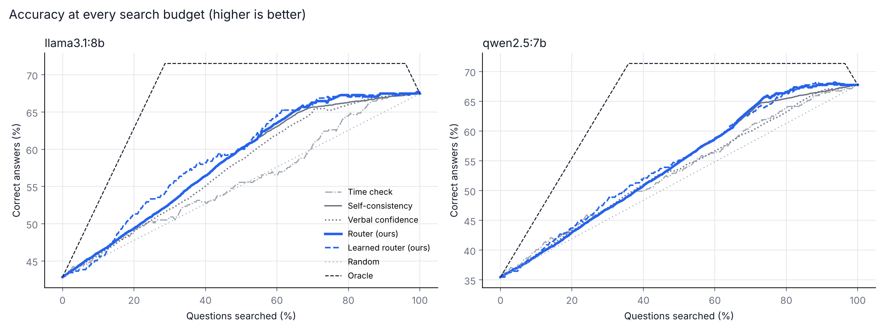

# Accuracy at every search budget

Each method ranks the questions by how much they need a search; searching the top k% gives accuracy at that budget. **Area** = mean accuracy over all budgets from 0% to 100% (higher is better), with a 95% bootstrap interval. The learned router uses out-of-fold probabilities (never tested on a question it trained on).

## llama3.1:8b (495 questions)

Never search 43% · always search 67%

| Method | Area (95% interval) | at 25% searched | at 50% | at 75% |
|---|---|---|---|---|
| Time check | 55.8% (52.0%-59.6%) | 50% | 56% | 63% |
| Self-consistency | 58.2% (54.5%-62.0%) | 51% | 60% | 66% |
| Verbal confidence | 57.6% (53.6%-61.5%) | 51% | 59% | 65% |
| **Router (ours)** | 58.4% (54.7%-62.4%) | 51% | 60% | 67% |
| **Learned router (ours)** | 59.0% (55.2%-63.0%) | 53% | 60% | 67% |
| Random | 55.2% | 49% | 55% | 61% |
| Oracle | 67.3% | 68% | 72% | 72% |

Paired comparison of areas (same questions resampled; an interval above zero means the router is reliably better):

| Router (ours) vs. | Difference in area | 95% interval |
|---|---|---|
| Time check | +2.6 points | +1.1 to +4.4 * |
| Self-consistency | +0.2 points | -0.1 to +0.6 |
| Verbal confidence | +0.9 points | -0.2 to +1.9 |
| Random | +3.3 points | |

## qwen2.5:7b (499 questions)

Never search 35% · always search 68%

| Method | Area (95% interval) | at 25% searched | at 50% | at 75% |
|---|---|---|---|---|
| Time check | 53.3% (49.5%-57.0%) | 46% | 53% | 62% |
| Self-consistency | 54.0% (50.3%-58.2%) | 45% | 55% | 65% |
| Verbal confidence | 53.3% (50.0%-57.4%) | 45% | 54% | 62% |
| **Router (ours)** | 54.3% (50.7%-58.5%) | 45% | 55% | 66% |
| **Learned router (ours)** | 54.6% (50.8%-58.7%) | 46% | 55% | 65% |
| Random | 51.6% | 44% | 52% | 60% |
| Oracle | 64.8% | 61% | 71% | 71% |

Paired comparison of areas (same questions resampled; an interval above zero means the router is reliably better):

| Router (ours) vs. | Difference in area | 95% interval |
|---|---|---|
| Time check | +1.0 points | -0.6 to +3.0 |
| Self-consistency | +0.3 points | +0.1 to +0.6 * |
| Verbal confidence | +1.0 points | -0.3 to +2.2 |
| Random | +2.7 points | |

