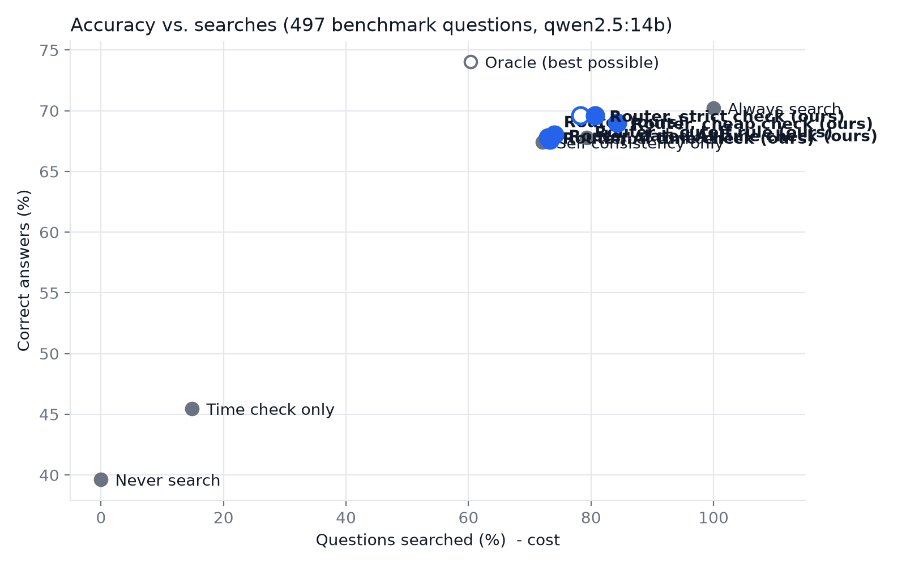

# Experiment: when should the AI search?

Model `qwen2.5:14b` · 2026-10-12 · 497/499 questions from public benchmarks (FreshQA 2026-04-21, PopQA)

Search used by the methods below: **Wikipedia + live web**.

## Main result

| Method | Correct (95% interval) | Wrong | No guess | Searched |
|---|---|---|---|---|
| Never search | 40% (36%-44%) | 240 | 60 | 0% |
| Always search | 70% (66%-74%) | 108 | 40 | 100% |
| Time check only | 45% (41%-50%) | 234 | 37 | 15% |
| Self-consistency only | 67% (63%-71%) | 123 | 39 | 72% |
| Verbal confidence | 68% (64%-72%) | 122 | 38 | 79% |
| **Router (ours)** | 68% (63%-72%) | 123 | 38 | 73% |
| **Router + cutoff rule (ours)** | 70% (66%-73%) | 113 | 38 | 78% |
| **Router, AI time check (ours)** | 68% (64%-72%) | 121 | 39 | 73% |
| **Router, dated AI time check (ours)** | 68% (64%-72%) | 121 | 38 | 74% |
| **Router, cheap check (ours)** | 69% (65%-73%) | 114 | 40 | 84% |
| **Router, strict check (ours)** | 70% (66%-73%) | 113 | 38 | 81% |
| Oracle (best possible) | 74% (70%-78%) | 98 | 31 | 60% |

## Correct answers by question type

| Question type | n | Never search | Always search | Time check only | Self-consistency only | Verbal confidence | Router (ours) | Router + cutoff rule (ours) | Router, AI time check (ours) | Router, dated AI time check (ours) | Router, cheap check (ours) | Router, strict check (ours) | Oracle (best possible) |
|---|---|---|---|---|---|---|---|---|---|---|---|---|---|
| Stable, famous (PopQA) | 129 | 71% | 79% | 71% | 81% | 80% | 81% | 81% | 81% | 81% | 78% | 81% | 86% |
| Stable, rare (PopQA) - incomplete | 128 | 27% | 66% | 27% | 66% | 66% | 66% | 66% | 66% | 66% | 66% | 66% | 67% |
| Never-changing (FreshQA) | 80 | 61% | 84% | 62% | 76% | 76% | 76% | 80% | 76% | 76% | 80% | 81% | 89% |
| Changing (FreshQA) - outdated | 160 | 14% | 60% | 32% | 54% | 56% | 54% | 59% | 55% | 56% | 59% | 58% | 62% |

## Share of questions searched, by type

| Question type | Time check only | Self-consistency only | Verbal confidence | Router (ours) | Router + cutoff rule (ours) |
|---|---|---|---|---|---|
| Stable, famous (PopQA) | 0% | 50% | 60% | 50% | 50% |
| Stable, rare (PopQA) - incomplete | 0% | 95% | 97% | 95% | 95% |
| Never-changing (FreshQA) | 4% | 42% | 59% | 44% | 62% |
| Changing (FreshQA) - outdated | 44% | 87% | 91% | 90% | 96% |

## Check 1 on FreshQA (outside data, not used for training)

- Right group (never/slow/fast = LOW/MAYBE/HIGH): 145/240 (60%)
- Fast-changing questions caught as HIGH: 49/80
- Check 1 asked to the AI instead: right group 188/240 (78%), fast-changing caught as HIGH 72/80
- Check 1 asked to the AI, told its cutoff and today's date: right group 159/240 (66%), fast-changing caught as HIGH 76/80

## Is the difference real? (paired McNemar test)

For each pair: questions only the router got right vs. only the other method got right. p < 0.05 means the difference is unlikely to be chance.

| Router vs. | Only router right | Only other right | p-value |
|---|---|---|---|
| Never search | 163 | 14 | 0.000 * |
| Always search | 5 | 8 | 0.581 |
| Time check only | 132 | 12 | 0.000 * |
| Self-consistency only | 12 | 1 | 0.003 * |
| Verbal confidence | 16 | 7 | 0.093 |

(Compared using: Router + cutoff rule (ours).)

## Cutoff rule

Model training cutoff: 2024-09 (2.1 years before the test date). With the cutoff rule, questions whose answers change *sometimes* (MAYBE) are also searched when the model's knowledge is more than a year old.

## How to read this

- **Never search** shows what the AI gets wrong on its own (outdated + incomplete knowledge).
- **Always search** is the most expensive option; searching can also hurt when the source is poor.
- **Oracle** searches only when the memory answer is wrong: the best any method could do.
- A good method gets close to the best accuracy while searching far fewer questions.

## Notes

- Scoring: an answer is correct if it contains one of the benchmark's accepted answers (automatic matching; see `experiment_answers.csv` to check by hand).
- FreshQA answers are as of 2026-04-21. Answers that changed since then were re-checked with sources (`data/gold_updates.csv`); broken questions are left out (`data/excluded_questions.csv`).
- Questions with a false premise were left out.
