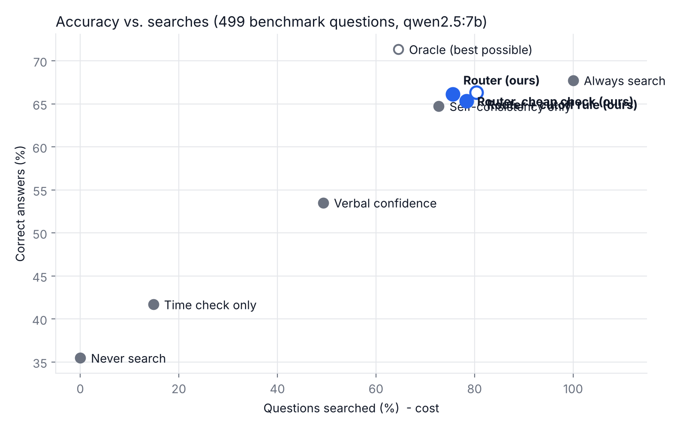

# Experiment: when should the AI search?

Model `qwen2.5:7b` · 2026-10-09 · 499/499 questions from public benchmarks (FreshQA 2026-04-21, PopQA)

Search used by the methods below: **Wikipedia + live web**.

## Main result

| Method | Correct (95% interval) | Wrong | No guess | Searched |
|---|---|---|---|---|
| Never search | 35% (31%-40%) | 281 | 41 | 0% |
| Always search | 68% (64%-72%) | 108 | 53 | 100% |
| Time check only | 42% (37%-46%) | 256 | 35 | 15% |
| Self-consistency only | 65% (61%-69%) | 126 | 50 | 73% |
| Verbal confidence | 54% (49%-58%) | 189 | 43 | 49% |
| **Router (ours)** | 66% (62%-70%) | 120 | 49 | 76% |
| **Router + cutoff rule (ours)** | 66% (62%-70%) | 118 | 50 | 80% |
| **Router, cheap check (ours)** | 65% (61%-69%) | 126 | 47 | 78% |
| Oracle (best possible) | 71% (67%-75%) | 100 | 43 | 65% |

## Correct answers by question type

| Question type | n | Never search | Always search | Time check only | Self-consistency only | Verbal confidence | Router (ours) | Router + cutoff rule (ours) | Router, cheap check (ours) | Oracle (best possible) |
|---|---|---|---|---|---|---|---|---|---|---|
| Stable, famous (PopQA) | 129 | 57% | 77% | 57% | 78% | 69% | 78% | 78% | 77% | 80% |
| Stable, rare (PopQA) - incomplete | 130 | 25% | 60% | 25% | 58% | 54% | 58% | 58% | 57% | 62% |
| Never-changing (FreshQA) | 80 | 57% | 86% | 60% | 80% | 71% | 80% | 80% | 82% | 91% |
| Changing (FreshQA) - outdated | 160 | 16% | 57% | 34% | 51% | 32% | 56% | 56% | 54% | 62% |

## Share of questions searched, by type

| Question type | Time check only | Self-consistency only | Verbal confidence | Router (ours) | Router + cutoff rule (ours) |
|---|---|---|---|---|---|
| Stable, famous (PopQA) | 0% | 59% | 40% | 59% | 59% |
| Stable, rare (PopQA) - incomplete | 0% | 88% | 75% | 88% | 88% |
| Never-changing (FreshQA) | 4% | 52% | 36% | 54% | 68% |
| Changing (FreshQA) - outdated | 44% | 81% | 42% | 89% | 98% |

## Search quality: each version of the search

Accuracy when ALWAYS searching (200 questions answered by every version).

| Question type | Improved Wikipedia search | Wikipedia + live web |
|---|---|---|
| Stable, famous (PopQA) | 62% | 72% |
| Stable, rare (PopQA) - incomplete | 30% | 62% |
| Never-changing (FreshQA) | 65% | 80% |
| Changing (FreshQA) - outdated | 25% | 49% |
| **All** | 42% | 62% |

## Check 1 on FreshQA (outside data, not used for training)

- Right group (never/slow/fast = LOW/MAYBE/HIGH): 145/240 (60%)
- Fast-changing questions caught as HIGH: 49/80

## Is the difference real? (paired McNemar test)

For each pair: questions only the router got right vs. only the other method got right. p < 0.05 means the difference is unlikely to be chance.

| Router vs. | Only router right | Only other right | p-value |
|---|---|---|---|
| Never search | 168 | 14 | 0.000 * |
| Always search | 4 | 11 | 0.118 |
| Time check only | 134 | 11 | 0.000 * |
| Self-consistency only | 12 | 4 | 0.077 |
| Verbal confidence | 75 | 11 | 0.000 * |

(Compared using: Router + cutoff rule (ours).)

## Cutoff rule

Model training cutoff: 2024-09 (2.1 years before the test date). With the cutoff rule, questions whose answers change *sometimes* (MAYBE) are also searched when the model's knowledge is more than a year old.

## How to read this

- **Never search** shows what the AI gets wrong on its own (outdated + incomplete knowledge).
- **Always search** is the most expensive option; searching can also hurt when the source is poor.
- **Oracle** searches only when the memory answer is wrong: the best any method could do.
- A good method gets close to the best accuracy while searching far fewer questions.

## Notes

- Scoring: an answer is correct if it contains one of the benchmark's accepted answers (automatic matching; see `experiment_answers.csv` to check by hand).
- FreshQA answers are as of 2026-04-21. Answers that changed since then were re-checked with sources (`data/gold_updates.csv`); broken questions are left out (`data/excluded_questions.csv`).
- Questions with a false premise were left out.
