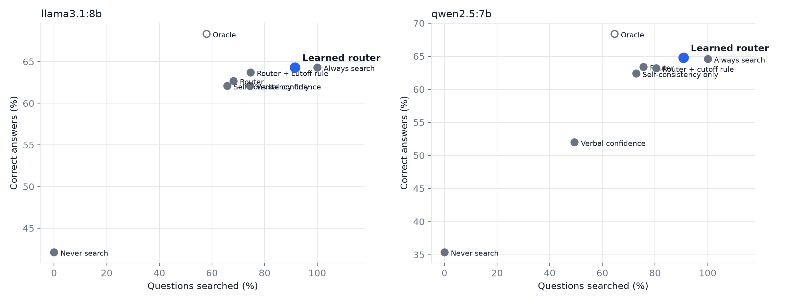

# Learned router

A logistic-regression model predicts whether the memory answer will be wrong, from signals available before answering: p_low, p_maybe, p_high, agreement, dont_know, confidence, abstained. It decides to search when that is likely. Results are **out-of-fold** (5-fold cross-validation, repeated 5 times): every question is decided by a model that never saw it.

## Accuracy and searches

| Method | llama3.1:8b correct | wrong | searched | qwen2.5:7b correct | wrong | searched |
|---|---|---|---|---|---|---|
| Never search | 42% | 170 | 0% | 35% | 282 | 0% |
| Always search | 64% | 129 | 100% | 65% | 123 | 100% |
| Self-consistency only | 62% | 143 | 66% | 62% | 137 | 73% |
| Verbal confidence | 62% | 142 | 74% | 52% | 196 | 49% |
| Router (ours) | 63% | 140 | 68% | 63% | 133 | 76% |
| Router + cutoff rule (ours) | 64% | 134 | 75% | 63% | 133 | 80% |
| **Learned router (ours)** | 64% | 129 | 92% | 65% | 124 | 91% |
| Oracle (best possible) | 68% | 116 | 58% | 68% | 114 | 65% |

## Is the learned router better? (paired McNemar test)

| Model | Learned vs. | Only learned right | Only other right | p-value |
|---|---|---|---|---|
| llama3.1:8b | Always search | 1 | 1 | 1.000 |
| llama3.1:8b | Self-consistency only | 17 | 6 | 0.035 * |
| llama3.1:8b | Router (ours) | 12 | 4 | 0.077 |
| qwen2.5:7b | Always search | 2 | 1 | 1.000 |
| qwen2.5:7b | Self-consistency only | 19 | 7 | 0.029 * |
| qwen2.5:7b | Router (ours) | 14 | 7 | 0.189 |

## Does it transfer to another AI model?

Trained on one model's questions, tested on the other model (no retraining).

| Trained on | Tested on | Correct | Searched |
|---|---|---|---|
| llama3.1:8b | qwen2.5:7b | 65% | 96% |
| qwen2.5:7b | llama3.1:8b | 64% | 92% |

## What the model learned

Weights of the final model (standardised signals; positive = more likely to search):

| Signal | Weight |
|---|---|
| dont_know | +0.91 |
| abstained | +0.80 |
| agreement | -0.49 |
| p_high | +0.25 |
| confidence | -0.24 |
| p_low | -0.22 |
| p_maybe | +0.07 |

